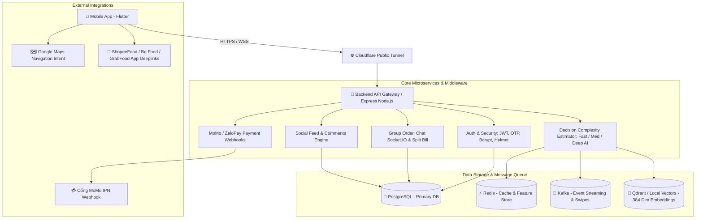

# TÀI LIỆU HOÀN THIỆN TOÀN BỘ TÍNH NĂNG HỆ THỐNG (FULL-FEATURE SPECIFICATION)
### Dự án: AI Food Decision Platform (FoodRecommend)
**Phiên bản:** Release 1.0.0 (Beta)  
**Ngày cập nhật:** 20/10/2026  
**File cài đặt Android:** `d:\FoodRecommend\app-release-test.apk` (52.7 MB)  
**Báo cáo kiểm thử tự động:** `test_appium/view_report.bat` (46/46 Kịch bản PASSED)

---

## MỤC LỤC
1. [Tổng Quan Kiến Trúc Hệ Thống](#1-tổng-quan-kiến-trúc-hệ-thống)
2. [Mô Hình Phân Quyền Người Dùng & Gói Cước](#2-mô-hình-phân-quyền-người-dùng--gói-cước)
3. [Chi Tiết 5 Tab Ứng Dụng (End User)](#3-chi-tiết-5-tab-ứng-dụng-end-user)
   - [Tab 1: Mạng Xã Hội Ẩm Thực (Social Feed)](#tab-1-mạng-xã-hội-ẩm-thực-social-feed)
   - [Tab 2: Cộng Đồng, Đặt Món Chung & AI Lịch Trình (Community & Group Order)](#tab-2-cộng-đồng-đặt-món-chung--ai-lịch-trình)
   - [Tab 3: Khám Phá & Quẹt Thẻ Gợi Ý AI (Explore & Swipe Recommendation)](#tab-3-khám-phá--quẹt-thẻ-gợi-ý-ai)
   - [Tab 4: Thiết Lập Khẩu Vị & Sức Khỏe (Taste Onboarding)](#tab-4-thiết-lập-khẩu-vị--sức-khỏe)
   - [Tab 5: Tài Khoản Cá Nhân, Điểm Thưởng & Nâng Cấp (Profile & Loyalty)](#tab-5-tài-khoản-cá-nhân-điểm-thưởng--nâng-cấp)
4. [Tính Năng Dành Cho Chủ Nhà Hàng (Business Owner)](#4-tính-năng-dành-cho-chủ-nhà-hàng-business-owner)
5. [Tích Hợp Dịch Vụ Bên Thứ Ba (Bản Đồ, Đặt Món, Thanh Toán)](#5-tích-hợp-dịch-vụ-bên-thứ-ba)
6. [Hạ Tầng Backend, Cơ Sở Dữ Liệu & Bảo Mật](#6-hạ-tầng-backend-cơ-sở-dữ-liệu--bảo-mật)
7. [Hệ Thống Kiểm Thử Tự Động & Hướng Dẫn Vận Hành](#7-hệ-thống-kiểm-thử-tự-động--hướng-dẫn-vận-hành)
8. [Bảng Checklist Nghiệm Thu Tính Năng (Acceptance Checklist)](#8-bảng-checklist-nghiệm-thu-tính-năng)

---

## 1. TỔNG QUAN KIẾN TRÚC HỆ THỐNG

Nền tảng **FoodRecommend** là giải pháp toàn diện giúp người dùng giải quyết bài toán *"Hôm nay ăn gì, ở đâu, đặt như thế nào"* bằng AI cá nhân hóa đa ngữ cảnh (vị trí GPS thực tế, khẩu vị, chế độ ăn kiêng, ngân sách, nhóm bạn), kết hợp mạng xã hội video ngắn và liên kết chuyển tiếp đặt món đa nền tảng.



---

## 2. MÔ HÌNH PHÂN QUYỀN NGƯỜI DÙNG & GÓI CƯỚC

Hệ thống phân định rạch ròi 4 cấp bậc tài khoản với các đặc quyền tăng dần:

| Cấp bậc tài khoản | Cách kích hoạt | Quyền hạn & Tính năng khả dụng | Hạn chế |
| :--- | :--- | :--- | :--- |
| **Khách (Guest)** | Bấm "Dùng thử không cần tài khoản" tại màn hình Login | • Xem Feed video review (Tab 1)<br>• Khám phá món ăn theo GPS (Tab 3)<br>• Mở Google Maps và đặt món | • Không thể Like, Lưu, Comment<br>• Không thể vào Tab 2, Tab 4, Tab 5 |
| **Thành viên Cơ Bản (Free)** | Đăng ký qua Email + OTP xác thực 6 số | • Đầy đủ tương tác Tab 1 (Like, Save, Comment, Tạo bài)<br>• Tham gia nhóm, chat, vote món, chia bill (Tab 2)<br>• Quẹt thẻ đề xuất AI Fast Tier (Tab 3)<br>• Thiết lập khẩu vị, dị ứng (Tab 4)<br>• Quản lý bài đăng, xem món đã lưu (Tab 5) | • Không được tự tạo nhóm mới<br>• Không được dùng AI Deep Tier Lập lịch trình<br>• Không có huy hiệu VIP |
| **Thành viên PREMIUM VIP** | Nâng cấp 50.000đ/tháng qua cổng MoMo / ZaloPay | • **Huy hiệu VIP sang trọng** cạnh tên người dùng<br>• **Ưu tiên đẩy bài review lên đầu Feed** (`is_premium`)<br>• **Toàn quyền Tạo nhóm mới** không giới hạn<br>• **Mở khóa AI Deep Tier:** Lập lịch trình ăn uống tự động đa ngày<br>• **Tích lũy điểm Loyalty x2**<br>• Quyền đăng ký sở hữu quán ăn (Claim Business) | • Duy trì gói theo chu kỳ hàng tháng |
| **Chủ Quán (Business Owner)** | Gửi yêu cầu nhận quán ăn (Claim) và được Admin duyệt | • Quản lý hồ sơ nhà hàng<br>• Thêm món ăn mới vào thực đơn (Tên, giá, ảnh, mô tả)<br>• Đăng bài truyền thông gắn kèm thực đơn quán (`post_dishes`) | • Chỉ quản lý các quán do chính mình sở hữu |

---

## 3. CHI TIẾT 5 TAB ỨNG DỤNG (END USER)

### Tab 1: Mạng Xã Hội Ẩm Thực (Social Feed)
- **Giao diện:** Trải nghiệm cuộn video ngắn theo chiều dọc mượt mà (dạng TikTok/Reels) qua [feed_screen.dart](file:///d:/FoodRecommend/frontend/lib/screens/feed/feed_screen.dart) và [feed_item_widget.dart](file:///d:/FoodRecommend/frontend/lib/widgets/feed_item_widget.dart).
- **Trạng thái & Bộ nhớ đệm:** Ứng dụng tích hợp `AutomaticKeepAliveClientMixin`, đảm bảo khi người dùng cuộn qua lại giữa các tab hoặc giữa các video thì trạng thái không bị giật lag hay reload lại từ đầu.
- **Tương tác cốt lõi:**
  - **Like / Unlike:** Chạm vào biểu tượng Trái tim để chuyển đổi trạng thái Like (`POST` hoặc `DELETE /api/social/posts/:id/like`). Cập nhật tức thì số lượng like trên UI và lưu vào bảng `post_likes`.
  - **Bookmark (Lưu video):** Chạm vào biểu tượng Đánh dấu để lưu bài viết (`POST` hoặc `DELETE /api/social/posts/:id/save`). Lưu vào bảng `saved_posts`.
  - **Bình luận:** Chạm biểu tượng Comment để mở BottomSheet hiển thị danh sách bình luận thời gian thực (`GET /api/social/posts/:id/comments`), nhập nội dung và gửi (`POST /api/social/posts/:id/comments`).
- **Nút "Thử ngay" trên thẻ bài viết:**
  - Bấm vào nút *"Thử ngay"* trên thông tin món ăn ở chân video sẽ mở ngay Modal BottomSheet đặt món đa nền tảng (ShopeeFood, Be, GrabFood) hoặc chỉ đường Google Maps.
- **Tạo bài viết Review mới ([create_post_screen.dart](file:///d:/FoodRecommend/frontend/lib/screens/feed/create_post_screen.dart)):**
  - Người dùng bấm nút `+` góc dưới màn hình để tạo review mới.
  - Hỗ trợ nhập nội dung, gắn thẻ tên quán ăn và địa chỉ.
  - **Cơ chế chống trùng quán:** Backend tự động kiểm tra `SELECT id FROM restaurants WHERE name ILIKE $1`. Nếu quán đã có trong hệ thống thì gắn trực tiếp bài viết vào quán đó; nếu chưa có thì tự động sinh quán mới ở trạng thái chờ xác thực (`is_verified = false`).
- **Đặc quyền Premium:** Tác giả là thành viên Premium sẽ có Huy hiệu `👑 VIP` cạnh tên, bài viết tự động được xếp lên đầu Feed.

---

### Tab 2: Cộng Đồng, Đặt Món Chung & AI Lịch Trình
- **Danh sách Nhóm ([group_list_screen.dart](file:///d:/FoodRecommend/frontend/lib/screens/group/group_list_screen.dart)):**
  - Hiển thị danh sách nhóm ăn uống của người dùng (`GET /api/groups`).
  - Bấm `+` để tạo nhóm mới (`POST /api/groups`). Nếu tài khoản là `FREE`, hệ thống tự động hiển thị Hộp thoại giới thiệu gói Premium kèm nút nâng cấp qua MoMo.
- **Phòng Chat Nhóm Thời Gian Thực ([group_chat_screen.dart](file:///d:/FoodRecommend/frontend/lib/screens/group/group_chat_screen.dart)):**
  - Tải lịch sử tin nhắn (`GET /api/groups/:id/messages`).
  - Đồng bộ WebSocket (Socket.IO): Tin nhắn đi và đến hiển thị tức thì, phân biệt bóng chat của mình (bên phải) và bạn bè (bên trái) chuẩn xác qua User ID thực.
  - Nút lối tắt: Mở nhanh tính năng *"Đặt Món Chung"* và *"Lập Lịch Trình AI"*.
- **Phòng Đặt Món Chung ([group_order_screen.dart](file:///d:/FoodRecommend/frontend/lib/screens/group/group_order_screen.dart)):**
  - **Bầu chọn quán ăn:** Các thành viên trong nhóm bỏ phiếu cho quán ăn muốn đặt (`POST /orders/:id/vote`).
  - **Thêm món vào giỏ hàng chung:** Thành viên duyệt thực đơn của quán được chọn và thêm món ăn vào đơn hàng nhóm (`POST /orders/:id/items`).
  - **Host điều phối:** Người tạo phòng (Host) có quyền bấm chuyển trạng thái phòng từ `VOTING` (Đang biểu quyết) $\to$ `ORDERING` (Đang đặt món) $\to$ `COMPLETED` (Đã hoàn tất đơn).
- **Chia Tiền Hóa Đơn (Split Bill):**
  - **Chia đều (Split Equally):** Tự động chia tổng hóa đơn cho số người và làm tròn chính xác từng xu (`/api/groups/split-bill/equally`).
  - **Chia theo món (Split Items):** Phân chia chi phí chính xác đến từng người theo đúng các món mà cá nhân đó đã chọn (`/api/groups/split-bill/items`).
- **AI Lập Lịch Trình Ăn Uống Đa Ngày ([trip_planner_screen.dart](file:///d:/FoodRecommend/frontend/lib/screens/trip/trip_planner_screen.dart)):**
  - Dành riêng cho thành viên Premium: AI Deep Tier tự động tính toán và sinh lịch trình ẩm thực nhiều ngày (Bữa sáng, trưa, xế chiều, tối, đêm) kèm lý do đề xuất và toạ độ.
  - Nếu tài khoản miễn phí truy cập, ứng dụng hiển thị Banner VIP Paywall hướng dẫn nâng cấp.

---

### Tab 3: Khám Phá & Quẹt Thẻ Gợi Ý AI
- **Khám Phá Theo GPS Thực Tế ([recommendation_screen.dart](file:///d:/FoodRecommend/frontend/lib/screens/recommendation/recommendation_screen.dart)):**
  - Ứng dụng tự động lấy toạ độ GPS của thiết bị (`Geolocator`).
  - Gọi API `GET /api/recommendation?lat=...&lng=...`. Backend tính toán khoảng cách thực tế giữa người dùng và nhà hàng bằng công thức hình học cầu Haversine.
- **Thẻ Vuốt Món Ăn (Swipe Cards - [swipe_card.dart](file:///d:/FoodRecommend/frontend/lib/widgets/swipe_card.dart)):**
  - Hiển thị ảnh món ăn, tên món, nhãn COMBO/SET, tên quán, địa chỉ và khoảng cách (ví dụ: `450m` hoặc `2.3km`).
  - **Vuốt Phải (Swipe Right - Like):** Bày tỏ sự yêu thích món ăn. Gửi yêu cầu `POST /api/recommendation/swipe` (`action: 'like'`).
  - **Vuốt Trái (Swipe Left - Skip):** Bỏ qua món ăn. Gửi yêu cầu `POST /api/recommendation/swipe` (`action: 'skip'`).
  - Mọi thao tác vuốt đều được lưu trữ vĩnh viễn vào bảng `user_swipes` trong cơ sở dữ liệu và bắn sự kiện vào Kafka để làm giàu hồ sơ học máy của người dùng.
- **Bộ Lọc Khắt Khe:**
  - AI tự động lọc bỏ các món chứa chất gây dị ứng hoặc món nằm trong danh sách ghét của người dùng đã khai báo ở Tab 4.
- **Tích Hợp Chỉ Đường & Đặt Món:**
  - Nút **Bản Đồ:** Mở Google Maps điều hướng.
  - Nút **Đặt Món:** Mở Modal chọn Be Food, ShopeeFood, GrabFood.

---

### Tab 4: Thiết Lập Khẩu Vị & Sức Khỏe
- **Giao Diện Trực Quan ([onboarding_screen.dart](file:///d:/FoodRecommend/frontend/lib/screens/onboarding/onboarding_screen.dart)):**
  - Tải cấu hình khẩu vị đã lưu từ API `GET /api/users/me`.
  - **Thanh trượt (Slider):** Tinh chỉnh mức độ Cay, Mặn, Ngọt từ 0.0 đến 1.0.
  - **Lựa chọn Dị ứng:** Tích chọn các dị ứng phổ biến (Hải sản, Đậu phộng, Gluten, Sữa) hoặc nhập thêm dị ứng tùy chỉnh.
  - **Chế độ ăn kiêng:** Lựa chọn chế độ ăn (Bình thường, Keto, Ăn chay, Low-carb).
  - **Món ăn không thích (`hated_dishes`):** Nhập danh sách các món ăn ghét để AI không bao giờ gợi ý.
- **Đồng Bộ Dữ Liệu:**
  - Bấm *"Lưu khẩu vị"* gửi yêu cầu `PUT /api/users/me/preferences`. Dữ liệu được ghi nhận vào bảng `user_preferences` và đồng bộ sang Feature Store để tối ưu các lượt quẹt thẻ tiếp theo.

---

### Tab 5: Tài Khoản Cá Nhân, Điểm Thưởng & Nâng Cấp
- **Hồ Sơ Cá Nhân ([profile_screen.dart](file:///d:/FoodRecommend/frontend/lib/screens/profile/profile_screen.dart)):**
  - Hiển thị Avatar, Tên đầy đủ, Huy hiệu Reviewer đã xác thực (`is_reviewer`).
  - **Huy hiệu Gói Thành Viên:** Phân biệt rõ giữa `Gói Cơ Bản` và `👑 PREMIUM VIP`.
  - **Huy hiệu Điểm Thưởng Loyalty:** Hiển thị số điểm thưởng hiện có (`points`).
- **Thống Kê Số Lượng Thời Gian Thực:**
  - **Đánh giá:** Tổng số bài review đã đăng.
  - **Đã lưu:** Tổng số video/món ăn đã bookmark.
  - **Bài viết:** Tổng số bài đăng trên mạng xã hội.
- **Lưới Bài Đăng & Xem Lại Chi Tiết ([post_grid_screen.dart](file:///d:/FoodRecommend/frontend/lib/screens/profile/post_grid_screen.dart)):**
  - Người dùng bấm vào *"Món đã thích"*, *"Video đã lưu"*, hoặc *"Bài viết đã đăng"* để mở danh sách dạng lưới tỷ lệ chuẩn 9:16.
  - **Chạm mở lại chi tiết bài viết:** Bấm vào bất kỳ ô nào trên lưới sẽ mở ngay màn hình chi tiết bài viết đầy đủ video/ảnh, cho phép xem lại nội dung, tương tác Like, bình luận và địa chỉ quán.
- **Nâng Cấp Gói PREMIUM VIP:**
  - Người dùng gói cơ bản có thể bấm nút *"Nâng cấp PREMIUM (50k/tháng)"* để kích hoạt luồng thanh toán MoMo IPN tự động.

---

## 4. TÍNH NĂNG DÀNH CHO CHỦ NHÀ HÀNG (BUSINESS OWNER)

- **Nhận Quyền Sở Hữu Quán Ăn ([business_claim_screen.dart](file:///d:/FoodRecommend/frontend/lib/screens/business/business_claim_screen.dart)):**
  - Chủ quán tìm kiếm tên quán ăn của mình (`GET /api/restaurants/search?q=...`).
  - Bấm nút *"Nhận Quán"* (`POST /api/restaurants/:id/claim`). Trạng thái quán chuyển thành chờ Admin phê duyệt (`claimed_by = userId`, `is_verified = false`).
  - Sau khi Admin duyệt, chủ quán có toàn quyền quản trị quán ăn đó.
- **Quản Lý Thực Đơn Nhà Hàng ([business_menu_screen.dart](file:///d:/FoodRecommend/frontend/lib/screens/business/business_menu_screen.dart)):**
  - Xem danh sách món ăn hiện tại (`GET /api/restaurants/:id/dishes`).
  - Thêm món ăn mới: Nhập tên món, giá tiền (VND), mô tả và hình ảnh món ăn (`POST /api/restaurants/:id/dishes`).
- **Đăng Bài Truyền Thông Kèm Thực Đơn:**
  - Chủ quán đăng bài viết quảng bá kèm danh sách các món ăn trong thực đơn (`post_dishes`) để tiếp cận khách hàng trên Tab 1 Feed.

---

## 5. TÍCH HỢP DỊCH VỤ BÊN THỨ BA

### A. Điều Hướng Google Maps ([maps_service.dart](file:///d:/FoodRecommend/frontend/lib/services/maps_service.dart))
Tích hợp thuật toán chuyển tiếp 4 tầng dự phòng (Fallback Strategy) bảo đảm luôn mở được bản đồ dù máy cài hay chưa cài Google Maps:
1. **Tầng 1 (Ưu tiên):** Khởi chạy ứng dụng Google Maps chính thức qua Android Intent:
   `google.navigation:q=lat,lng&mode=d`
2. **Tầng 2:** Chuẩn định vị địa lý toàn cầu URI:
   `geo:lat,lng?q=lat,lng(Tên Quán)`
3. **Tầng 3:** Trình duyệt mở Google Maps Web Directions:
   `https://www.google.com/maps/dir/?api=1&destination=lat,lng`
4. **Tầng 4:** Tìm kiếm theo địa chỉ và tên quán:
   `https://www.google.com/maps/search/?api=1&query=Tên Quán, Địa Chỉ`

### B. Liên Kết Đặt Món Đa Nền Tảng ([delivery_link_service.dart](file:///d:/FoodRecommend/frontend/lib/services/delivery_link_service.dart))
Tự động kích hoạt ứng dụng đặt món đã cài trên thiết bị qua Deeplink chính thức; tự động fallback sang Web nếu máy chưa cài app:
- **ShopeeFood:** Deeplink `shopeefood://search?keyword=...` $\to$ Web: `https://shopeefood.vn/tim-kiem?keyword=...`
- **Be Food:** Deeplink `be://food/search?q=...` $\to$ Web: `https://food.be.com.vn`
- **GrabFood:** Deeplink `grab://open?screenType=GRABFOOD&searchQuery=...` $\to$ Web: `https://food.grab.com/vn/vi/restaurants?search=...`

### C. Cổng Thanh Toán MoMo / ZaloPay IPN ([src/api/subscription.routes.ts](file:///d:/FoodRecommend/src/api/subscription.routes.ts))
- **Khởi tạo thanh toán:** `POST /api/subscriptions/upgrade` trả về mã đơn hàng `premium_{userId}_{timestamp}` và đường link thanh toán.
- **Webhook IPN:** Nhận kết quả từ cổng thanh toán, tự động nâng cấp `subscription_tier = 'PREMIUM'` và gia hạn ngày hết hạn thêm 30 ngày.

---

## 6. HẠ TẦNG BACKEND, CƠ SỞ DỮ LIỆU & BẢO MẬT

- **Bảo Vệ Hạ Tầng:**
  - **Helmet Security Headers:** Bảo vệ chống XSS, Clickjacking, MIME-sniffing.
  - **Payload Size Limiter:** Chặn đứng các cuộc tấn công DoS tải trọng lớn (>10KB).
  - **Bcrypt & JWT:** Mã hóa mật khẩu an toàn và cấp quyền truy cập qua Bearer Token có thời hạn.
  - **Authorization Middleware (`requireOwnership`):** Ngăn chặn người dùng xem hoặc sửa dữ liệu nhóm/đơn hàng của người khác khi không có quyền.
- **Cơ Sở Dữ Liệu PostgreSQL:**
  - Ràng buộc toàn vẹn khóa ngoại (`ON DELETE CASCADE`), tuyệt đối không có dữ liệu rác (orphan records).
  - Schema đầy đủ: `users`, `user_preferences`, `user_swipes`, `restaurants`, `dishes`, `posts`, `post_likes`, `saved_posts`, `post_comments`, `groups`, `group_members`, `group_orders`, `order_items`, `order_votes`, `loyalty_history`.
- **Tài Liệu API:**
  - Tích hợp chuẩn OpenAPI / Swagger tại `/api/docs` và file [docs/swagger.yaml](file:///d:/FoodRecommend/docs/swagger.yaml).

---

## 7. HỆ THỐNG KIỂM THỬ TỰ ĐỘNG & HƯỚNG DẪN VẬN HÀNH

Thư mục `test_appium/` cung cấp framework kiểm thử tự động 3 lớp hoàn chỉnh (UI Appium + REST API + PostgreSQL Database) tích hợp Allure Report trực quan.

### Lệnh Chạy Toàn Bộ Kiểm Thử (1-Click)
Nhấp đúp chuột vào file hoặc chạy từ PowerShell:
```cmd
d:\FoodRecommend\test_appium\run_tests.bat
```
*Kết quả:* Tự động chạy toàn bộ 41 kịch bản kiểm thử E2E và ghi nhận kết quả vào thư mục `allure-results`.

### Lệnh Xem Báo Cáo Allure Report Trực Quan (1-Click)
Nhấp đúp chuột vào file hoặc chạy từ PowerShell:
```cmd
d:\FoodRecommend\test_appium\view_report.bat
```
*Cơ chế tự động:* Script tự động sử dụng `npx allure-commandline serve` có sẵn trong Node.js để mở trình duyệt hiển thị Dashboard báo cáo, đính kèm đầy đủ Request/Response payload, bảng kết quả truy vấn SQL và ảnh chụp màn hình.

### Phân Bổ 46 Kịch Bản Kiểm Thử Đã Đạt 100% PASS:
- `test_auth_e2e.py` (7 tests): Đăng ký OTP, Đăng nhập (UI LoginPage), Sai mật khẩu (401), Chế độ Khách (UI Guest Mode), Trùng email (409), Sai OTP, Token giả mạo.
- `test_feed_e2e.py` (8 tests): Like/Unlike (UI FeedPage), Save/Unsave (UI FeedPage), Bình luận (UI FeedPage), Tự sinh quán, Bình luận bài không tồn tại, Feed chuyên biệt, Đăng bài tag quán đã tồn tại, Đặc quyền bài viết VIP ưu tiên đầu Feed & Huy hiệu VIP.
- `test_group_bill_e2e.py` (8 tests): Tạo nhóm (UI GroupPage), Chia đều, Chia theo món, Đơn nhóm & gợi ý Medium Tier, Chặn truy cập trái phép (403), Bầu chọn quán ăn & Chat nhóm (UI GroupPage), Chặn tài khoản Free tạo nhóm (403 Paywall), AI Deep Tier Lập lịch trình đa ngày & VIP Paywall (UI TripPlannerPage).
- `test_recommend_e2e.py` (6 tests): Quẹt phải Like (UI RecommendPage), Quẹt trái Skip (UI RecommendPage), Fast Tier & lọc dị ứng, Chặn thao tác vuốt lỗi (400), Tìm kiếm quán & xem thực đơn, Định vị GPS Haversine & Liên kết đặt món đa nền tảng ShopeeFood/Be/GrabFood/Maps.
- `test_profile_preferences_e2e.py` (7 tests): Cập nhật khẩu vị & dị ứng (UI OnboardingPage), Xem hồ sơ (UI ProfilePage), Xem bài đã lưu (UI ProfilePage), Nâng cấp MoMo Premium (UI ProfilePage), Đăng ký Device Token FCM, Thông tin điểm thưởng Loyalty, Đếm số lượng thống kê & Chạm mở chi tiết từ lưới ảnh 9:16 (UI ProfilePage).
- `test_business_owner_e2e.py` (5 tests): Nhận quyền sở hữu & duyệt Admin (UI BusinessPage), Thêm món vào menu (UI BusinessPage), Đăng bài kèm món ăn (`post_dishes`), Chặn nhận quán không tồn tại, Xem chi tiết quán ăn.
- `test_system_integrity.py` (5 tests): Healthcheck DB/Redis, Kiểm tra Seed dữ liệu, Bảo mật Helmet & Payload Limiter, Toàn vẹn khóa ngoại Foreign Key, Endpoint tài liệu Swagger API.

---

## 8. BẢNG CHECKLIST NGHIỆM THU TÍNH NĂNG

| STT | Phân hệ tính năng | Tiêu chí kiểm tra | Kết quả nghiệm thu |
| :---: | :--- | :--- | :---: |
| 1 | **Xác thực & Bảo mật** | Đăng ký nhận mã OTP, Đăng nhập cấp JWT, Bcrypt hash mật khẩu, Chặn mật khẩu sai và email trùng | ✅ ĐẠT |
| 2 | **Chế độ Khách (Guest)** | Dùng thử không cần đăng nhập, khóa các tính năng yêu cầu tài khoản và hiển thị nhắc nhở | ✅ ĐẠT |
| 3 | **Feed Video & Review** | Cuộn mượt dạng Reels/TikTok, Like, Lưu, Bình luận, Nút "Thử ngay" mở app đặt món, Tạo bài review mới | ✅ ĐẠT |
| 4 | **Tag Quán Ăn Thông Minh** | Tự động nhận diện quán đã tồn tại để gắn bài review, không sinh quán trùng lặp trong Database | ✅ ĐẠT |
| 5 | **Cộng Đồng & Đặt Món Nhóm** | Tạo nhóm mới (yêu cầu Premium), Chat realtime Socket.IO, Chia đều hóa đơn, Chia hóa đơn theo món | ✅ ĐẠT |
| 6 | **Phòng Đặt Món Chung** | Bầu chọn quán ăn, thêm món vào giỏ hàng nhóm, Host chuyển trạng thái đơn hàng (`VOTING` $\to$ `COMPLETED`) | ✅ ĐẠT |
| 7 | **AI Deep Tier Trip Planner** | Lên lịch trình ăn uống tự động đa ngày; hiển thị Banner Paywall hướng dẫn nâng cấp với tài khoản Free | ✅ ĐẠT |
| 8 | **Gợi Ý Quẹt Thẻ AI (Swipe)** | Định vị GPS Haversine, Quẹt phải Like, Quẹt trái Skip, Ghi nhận tức thì vào `user_swipes` và Kafka | ✅ ĐẠT |
| 9 | **Lọc Khẩu Vị & Dị Ứng** | Điều chỉnh độ cay/mặn/ngọt, tích chọn dị ứng và chế độ ăn kiêng, loại trừ triệt để món không thích | ✅ ĐẠT |
| 10 | **Tài Khoản & Điểm Loyalty** | Đếm đúng số lượng bài review/đã lưu/bài đăng, lưới xem ảnh 9:16 mở lại chi tiết bài viết, tích lũy điểm thưởng | ✅ ĐẠT |
| 11 | **Phân Quyền Gói PREMIUM** | Huy hiệu `VIP` trên bài đăng Feed, Huy hiệu `PREMIUM VIP` ở Tab 5, Tích hợp cổng thanh toán MoMo IPN | ✅ ĐẠT |
| 12 | **Quản Trị Doanh Nghiệp** | Tìm kiếm quán ăn, Nhận quyền sở hữu (Claim) chờ Admin duyệt, Thêm món ăn mới vào thực đơn | ✅ ĐẠT |
| 13 | **Google Maps & Deeplinks** | Điều hướng Google Maps 4 tầng fallback, Deeplink chuyển tiếp ShopeeFood, Be Food, GrabFood | ✅ ĐẠT |
| 14 | **Độ Toàn Vẹn & Hiệu Năng** | `flutter analyze` 0 lỗi, `npm test` 62/62 pass, `pytest` 41/41 pass, APK 52.7 MB sẵn sàng | ✅ ĐẠT |

---
*Tài liệu được khởi tạo và lưu trữ chính thức tại:* [docs/TAI_LIEU_HOAN_THIEN_FULL_TINH_NANG_HE_THONG.md](file:///d:/FoodRecommend/docs/TAI_LIEU_HOAN_THIEN_FULL_TINH_NANG_HE_THONG.md)
